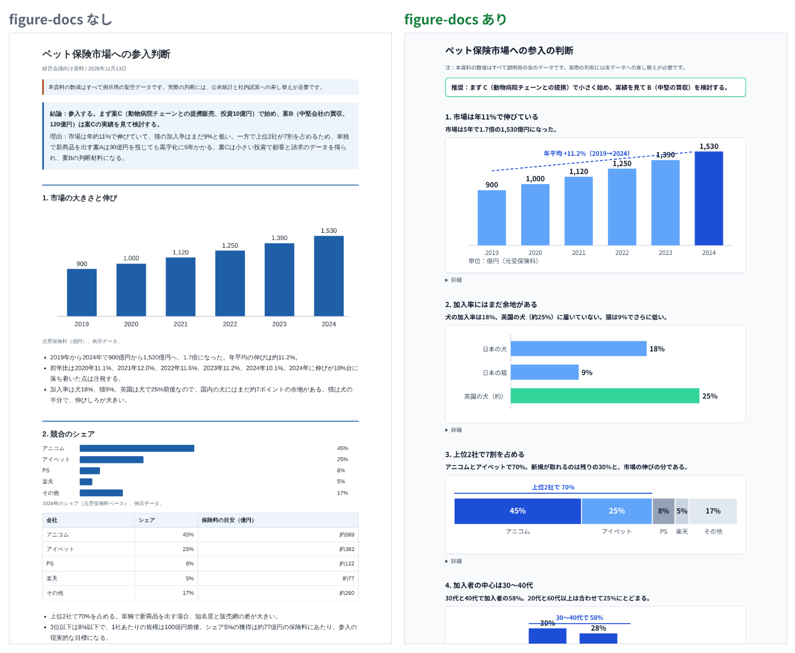
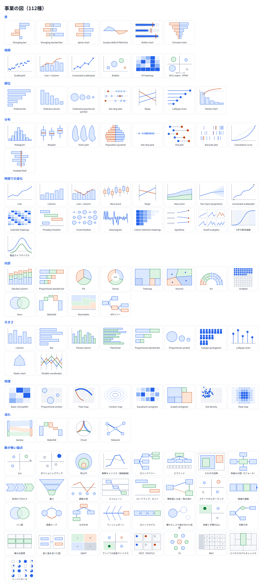
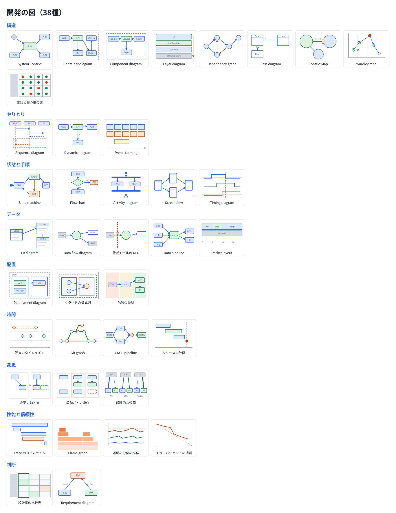

# agent-plugins

u-ichi が公開する、エージェント向けの plugin の置き場所。どの plugin も、Claude Code の plugin と [Agent Plugins](https://agent-plugins.org/)（Codex、Cursor、GitHub Copilot など）の両方の形で置く。中身の skill は [Agent Skills](https://agentskills.io/) の `SKILL.md` で、どちらからも同じものを読む。

| plugin | 中身 |
|---|---|
| [figure-docs](plugins/figure-docs) | 人に読ませる資料（報告、草案、比較や判断の資料、事業の資料、開発の説明）を、HTML のページ、Artifact、Markdown で図を中心に作り切るための skill。言いたいことから図の形を選ぶ順、資料の形式と字体、事業の図112種（[business.html](plugins/figure-docs/skills/figure-docs/references/business.html)）と開発の図38種（[dev.html](plugins/figure-docs/skills/figure-docs/references/dev.html)）の見本を持つ |

## figure-docs で何ができるか

同じ依頼（「ペット保険市場に参入すべきかを判断する資料を作って」、数値は架空）で、figure-docs を読ませない場合と読ませた場合に Claude が作った資料の先頭部分。読ませた方は、節ごとに見出しを言いたいこと1文にし、要点1行と図を置き、詳細は畳む。資料全体では、図が1つから7つに増え、表は4つから0になり、見えている文字はおよそ1,770字から490字に減った。



形は次の一覧から、言いたいことに合わせて選ぶ。各図の名前、形、使う場面は見本のファイル（[business.html](plugins/figure-docs/skills/figure-docs/references/business.html)、[dev.html](plugins/figure-docs/skills/figure-docs/references/dev.html)）にある。





## 入れ方

Claude Code：

```sh
/plugin marketplace add u-ichi/agent-plugins
/plugin install figure-docs@u-ichi
```

claude.ai（Claude のプロジェクトとクラウドのセッション）：https://claude.ai/customize/plugins の Add > Add marketplace で `u-ichi/agent-plugins` を足し、figure-docs を追加してオンにする。

Agent Plugins に対応したツール：`plugins/figure-docs/` が plugin のフォルダ（直下に `plugin.json` と `skills/`）。入れ方はツールごとの説明に従う。

skill だけを使うとき：`plugins/figure-docs/skills/figure-docs/` を、使うツールの skill のフォルダに写す。

## 置き方

```
.claude-plugin/marketplace.json        Claude Code の marketplace
plugins/<名前>/plugin.json              Agent Plugins の manifest
plugins/<名前>/.claude-plugin/plugin.json  Claude Code の manifest
plugins/<名前>/skills/<skill>/SKILL.md   両方が読む skill
```

## ライセンス

MIT（[LICENSE](LICENSE)）。事業の図の分類と名前は Financial Times Visual Vocabulary（MIT）による。著作権の表示は [plugins/figure-docs/LICENSES/FT-Visual-Vocabulary.txt](plugins/figure-docs/LICENSES/FT-Visual-Vocabulary.txt)。
