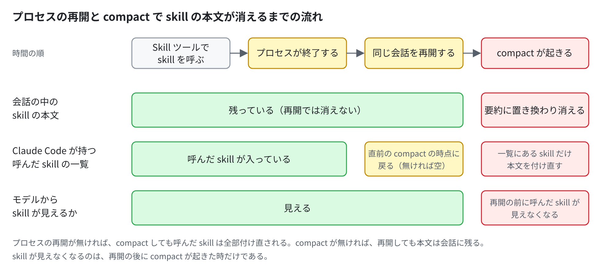

# claude-compact-restore

Claude Code の compact で起きる、原因の違う2つの問題に対処する plugin である。設定は無く、plugin を入れて有効にするだけで動く。hook だけで成り立ち、skill は持たない。hook に対応するのは Claude Code である。

この plugin が対処するのは次の2つである。

1. compact の仕様によって、会話に1回しか入っていない物が要約の言い換えだけになる。対象は claude.ai のプロジェクト（Claude Projects）の「プロジェクト指示」と、会話の途中で読んだ plugin の Markdown である。不具合ではなく compact の仕様によるもので、プロセスの再開が無くても compact のたびに起きる。この plugin は compact の後にそれぞれの本文を入れ直す。
2. Claude Code の不具合によって、プロセスの再開をはさんだ compact で、Skill ツールで呼んだ skill の本文が付け直されない。この plugin は付け直されなかった skill について Skill ツールでの呼び直しを求める。

Python 3.9 以上で動作し、標準ライブラリだけを使う。hook は失敗しても会話を止めず、読めない物があれば何もしない。サブエージェントのイベントでは何もしない。

## compact の仕様でプロジェクト指示と読んだ plugin の Markdown が無くなる問題

検証の詳しい方法と結果は [プロジェクト指示の入れ直しの検証結果](docs/verification-project-instructions.md) にある。

### 何が起きるかと原因

claude.ai のプロジェクト（Claude Projects）だけにある「プロジェクト指示」は、compact が起きると全文が会話から無くなり、書き方などのルールが落ちる。不具合ではなく compact の仕様（要約の性質）によるものである。compact は会話全体を要約に置き換え、プロジェクト指示は会話の最初のメッセージにしか入らないため、要約の中の言い換えだけが残る。プロセスの再開が無くても compact のたびに起きる。

会話の途中で読んだ plugin の Markdown（skill の references や playbook など、手順を書いた物）も compact で要約に置き換わる。Claude Code は compact の直後に、読んだか編集したファイルのうち最近更新された5つまでを読み直し、5,000 トークンを超えるファイルはパスだけになる（[Claude Code 公式文書（Context window）](https://code.claude.com/docs/en/context-window.md)）。それ以外は要約の言い換えだけが残る。

`CLAUDE.md` は Claude Code が compact の後に自分で入れ直すため、この plugin の対象外である。

### この plugin の対処

#### プロジェクト指示

Claude Code の compact では PreCompact、要約の作成、SessionStart（`source` が `compact`）、PostCompact の順に処理が進む。利用者がファイルを用意してパスを設定する必要は無い。

- `SessionStart`（`source` が `compact`）の hook が、transcript の最初の `user` の行にある `<project-instructions nonce="...">` から同じ nonce の閉じタグ `</project-instructions nonce="...">` までの中身（タグと前後の空白を除く）を取り出し、前置きを付けて `additionalContext` で出力する。nonce が違う閉じタグでは切らない。
- transcript のファイルが無い環境のために、`UserPromptSubmit` の hook が `prompt` に同じ形のブロックがあれば中身を状態ファイルに保存する（新しい物で上書きする）。transcript から取れないときはこの保存内容を使う。どちらも無ければ何もしない。
- Claude Code は hook 1つの追加の文脈を UTF-16 の単位で 10,000 文字で切るため、9,000 単位を超えるときは2つの hook に分けて出力する。2つでも入らない長さのときは、全文を状態ファイルと同じフォルダの `<session_id>-instructions.md` に書き、そのファイルを Read で読み直すよう求める文だけを出す。

プロジェクト指示のブロックが無い会話（claude.ai のプロジェクトを使わない Claude Code）では何もしない。`CLAUDE.md` は対象外である。

#### 読んだ plugin の Markdown

- `PostToolUse` の hook が全文を読んだ Markdown を状態ファイルに記録する。全文を読んだと数えるのは、`offset`・`limit` なしの `Read` ツールと、Bash の `cat` などで出力にファイルの全文がそのまま出た読み取りである。出力が切り詰められた物や一部だけの読み取りは数えない。
- 対象は、実パスが `~/.claude/plugins` の下にある Markdown と、`Skill` ツールの結果の `Base directory for this skill:` の行が示すフォルダの下にある Markdown である。`Read` ツールや Bash の `cat` で全文を読んだ `SKILL.md` もほかの Markdown と同じ条件で記録する（`Skill` ツールでは呼べず、`SKILL.md` を `Read` で読む skill があるため）。`Skill` ツールで呼んだだけの skill の `SKILL.md` は2つ目の問題の対処で戻すため、記録しない。
- `SessionStart`（`compact`）で、記録した Markdown を全部「戻す対象」にする。
- `PreToolUse` の hook が戻す対象から次の3つを除き、残りのファイルの今の本文を `additionalContext` で差し込む。1回に 9,000 UTF-16 単位まで差し込み、入らない分は次の tool の呼び出しで続ける。差し込みの途中でファイルの内容が変わったときは、今の本文の最初から差し込み直す。
  - 最後の `compact_boundary` の行の後に、`attachment.type` が `file` でそのパスの attachment がある物（Claude Code が全文を付け直した物）。パスだけの `compact_file_reference` は付け直されていない物として扱う。
  - compact の後に同じ見方で全文を読み直した物。
  - Claude Code か `Skill` ツールで本文が戻った skill の `SKILL.md`（同じ本文が2回入らないようにするため）。最後の `compact_boundary` の行の後の `invoked_skills` の attachment で付け直された skill については `skills[].content` の1行目の `Base directory for this skill:` の行が示すフォルダの `SKILL.md` を、compact の後に `Skill` ツールで呼び直した skill についてはその `SKILL.md` を除く。
- transcript が読めないときは、戻す対象を全部差し込む。
- 差し込み終わるまで、返信の tool（`mcp__hearthbot__message_coordinator`、`mcp__hearthbot__message_thread`、`mcp__hearthbot__edit_message`、`mcp__hearthbot__request_decision`、`mcp__hearthbot__no_reply_needed`、`mcp__hearthbot__start_thread`）と `Agent` の呼び出しを止め、差し込んだ内容に従って見直してからもう一度呼ぶよう求める。
- `mcp__hearthbot__post_message` と `mcp__hearthbot__post_widget` は止めず、差し込みだけを行う（呼び出し中に本文が画面に出る tool で、止めると本文が消えるため）。それ以外の tool も止めない。

### 測定結果

合成の場面での測定（169 回）では、プロジェクト指示の全文を入れ直すことで、compact の後のルール違反が平均 13.7 件から 1.5 件に減った。同じ測定では手順書ファイルを読み直させる案は差が出なかった（何もしない実行でもモデルが自分で読み直していた）。この plugin は、モデルが自分で読み直さなかった場合にも今の本文が会話に入るように、読んだ plugin の Markdown を戻す。

## Claude Code の不具合で skill の本文が付け直されない問題

検証の詳しい方法と結果は [skill の付け直しと呼び直しの検証結果](docs/verification-skill-reattach.md) にある。

### 何が起きるかと原因

Claude Code 2.1.328、2.1.330、2.1.331 で確認した Claude Code の不具合である。プロセスの再開をはさんだ compact で、Skill ツールで呼んだ skill の本文が付け直されない。

Claude Code の compact は、プロセスが持つ「呼んだ skill の一覧」にある skill の本文を compact の後に付け直す。プロセスを終了して同じ会話を再開（resume）すると、この一覧は直前の compact で付け直した内容（それまで compact が無ければ空）に戻る。そのため、再開より前に呼んだ skill が一覧から落ち、次の compact で付け直されない。



図は横が時間の順（skill を呼ぶ、プロセスの終了、再開、compact）、縦が「会話の中の skill の本文」「Claude Code が持つ呼んだ skill の一覧」「モデルから skill が見えるか」の3段である。

Claude Code の中のどの処理を直すべきかは外からは分からない。再開時に一覧を会話の記録から作り直すのか、compact の処理が会話の記録を見るのかは判断できない。

### 起きる条件と起きやすい環境

この不具合は次の順に起きたときに発生する。

1. Skill ツールで skill を呼ぶ。
2. プロセスが終了して同じ会話を再開する。
3. compact が起きる。

再開だけでは skill の本文が会話に残るため害は出ない。同じプロセスの中で compact だけを行う場合も、呼んだ skill は全部付け直される。

この不具合は Claude Code のものであり、プロセスの終了と再開が多い使い方ほど起きやすい。claude.ai のプロジェクト（Claude Projects）では、返信を終えて次の入力を待つ間に Claude Code のプロセスが終了し、次の入力で会話を再開する。観測した会話では、返信を終えてから次の入力まで6分半以上空いた6回の全部で、プロセスが終了して再開していた。`claude -p --resume` を繰り返す使い方や、Claude Code を閉じて `--resume` で続ける使い方でも同じ順になる。

### この plugin の対処

この処理はどの Claude Code でも使える。対象はすべての skill である。

`PreToolUse` の hook が transcript を読み、最後の `compact_boundary` の行より前に `Skill` ツールで呼んだ skill のうち、次の両方を満たす物について `Skill` ツールでの呼び直しを求める。

- 境目の後の `invoked_skills` に無い
- 境目の後に呼び直されてもいない

呼び直すまで tool の呼び出しを止める。止めないのは `Skill`、`ToolSearch`、`mcp__hearthbot__post_message`、`mcp__hearthbot__post_widget` である。名前は `plugin:skill` の形と、`:` より後ろの名前のどちらで呼んでも同じ skill として照合する。すでに `invoked_skills` にある skill は求めないため、本文が二重に入ることはない。サブエージェントの呼び出しは対象外である。

transcript のファイルが無いときは、`PostToolUse` で記録した `Skill` ツールの呼び出しを使い、compact の後に呼び直されていない物を全部求める（Claude Code が付け直したかが分からないため）。

### 観測結果

3つの会話（Claude Code 2.1.328、2.1.330、2.1.331）で同じ欠落を確認した。

1つ目の会話では compact が2回起きた。

- 1回目（2026-11-24）は compact の前に4つの skill を呼んだ。うち2つはプロセスの再開より前、2つは再開の後に呼んだ。付け直されたのは再開の後に呼んだ2つだけだった。
- 2回目（同日）は1回目の後に呼び直しを含め5つの skill を呼んだが、その後にプロセスの再開が5回あった。付け直されたのは1回目に付け直された2つだけで、本文も1回目の時点のままだった。その間に skill が更新されていても古い本文が残った。

2つ目の会話でも compact が2回起きた。

- 1回目（2026-11-19、Claude Code 2.1.328）は compact の前に Skill ツールを6回呼び、その間にプロセスの再開が4回あった。compact の後に `invoked_skills` は付かず、skill は1つも付け直されなかった。
- 2回目（2026-11-22、Claude Code 2.1.330）は Skill ツールの呼び出しが累計17回、前の compact からのプロセスの再開が7回あった。付け直されたのは2つの skill だけだった。
- どちらの compact でも、Read ツールで読んだファイルは付け直された。この会話では作業の一覧（TaskCreate）を5件使っていたが、compact の前に全部完了していたため、未完了の作業の一覧が欠落するかは分からなかった。

3つ目の会話（Claude Code 2.1.330、2026-11-23 の compact）では、compact の前に Skill ツールを3回呼び、プロセスの再開が1回あり、compact の後に `invoked_skills` は付かなかった。この会話は未完了の作業（TaskCreate）が1件ある状態で compact したが、作業の一覧にあたる物は compact の後に付いていなかった。

同じプロセスの中で compact した測定では、呼んだ skill が 78 回中 78 回、全部付け直された。

### skill 以外の物

同じ観測（3つの会話、Claude Code 2.1.328、2.1.330、2.1.331）で、compact の直後に Claude Code が会話の記録に付け直した物を比べた。

| compact の後に付け直す物 | プロセスの再開より前の分 | 根拠 |
| --- | --- | --- |
| Skill ツールで呼んだ skill の本文（`invoked_skills`） | 欠落する | 1つ目の会話では2回ともプロセスの再開より前に呼んだ分が付かず、2つ目と3つ目の会話でも同じ欠落を確認した |
| Read ツールで読んだファイル（`compact_file_reference` と `file`） | 欠落しなかった | 1つ目の会話の2回目の compact で5回のプロセスの再開より前に読んだ3つのファイルが3つとも付き、2つ目の会話でも2回とも付け直された |
| ToolSearch で読み込んだ tool の一覧（`compact_boundary` の行の `compactMetadata.preCompactDiscoveredTools`） | 欠落しなかった | 1つ目の会話でプロセスの再開より前に読み込んだ tool が2回目の記録に残っていた |

作業の一覧（TaskCreate で作る物）、plan mode の計画、動いているバックグラウンドの処理の一覧は欠落するかどうか未確認である。作業の一覧については、2つ目の会話では5件とも compact の前に完了しており、3つ目の会話では未完了の作業が1件ある状態で compact したが、作業の一覧にあたる物は compact の後に付いていなかった。ただし Claude Code が作業の一覧を compact の後に付け直す作りかどうかが分からないため、欠落とは判断できない。plan mode の計画と動いているバックグラウンドの処理の一覧は、観測した会話では compact の時点で使っていなかった。

この不具合への対処としてこの plugin が補うのは skill だけである。未確認の物は補っていない。

### 確認の方法

Claude Code の更新後にこの不具合が残っているかは、会話の記録（transcript の JSONL）で確認できる。

1. `"subtype": "compact_boundary"` の行を探す。
2. その行より後にある `"type": "attachment"` で `attachment.type` が `invoked_skills` の行を開き、`skills[].name` を確認する。
3. 同じ `compact_boundary` より前にある assistant の `tool_use` のうち、`name` が `Skill` の行の `input.skill` と比べる。

呼んだのに一覧に無い skill が、付け直されなかった skill である。

## 補わないもの

次の3つは補わない。

- 利用者の発言の再掲
- 要約を作るモデルへの指示
- 進捗の一覧の再掲

合成の場面での測定（169 回）では、これらを補っても compact の後のルール違反の数に差が出なかった。

## 状態ファイルと hook

状態ファイルは `<一時フォルダ>/claude-compact-restore/<session_id>.json`（Python の `tempfile.gettempdir()` が返すフォルダ）に会話ごとに1つ置く。書き込みは `fcntl` で排他する。テスト用に限り、環境変数 `CLAUDE_COMPACT_RESTORE_STATE_DIR` で状態ファイルの置き場所を変えられる（利用者の設定ではない）。

登録する hook は `SessionStart`（matcher `compact`、hook 2つ）、`UserPromptSubmit`、`PreToolUse`（`*`）、`PostToolUse`（`*`）である。

## 入れ方

Claude Code では次のコマンドを順に実行する。

```text
/plugin marketplace add u-ichi/agent-plugins
/plugin install claude-compact-restore@u-ichi
```

claude.ai では https://claude.ai/customize/plugins の **Add** > **Add marketplace** で `u-ichi/agent-plugins` を追加して有効にする。

## Claude Code 側で skill の不具合が直ったら

プロセスの再開をはさんだ compact でも、呼んだ skill が全部 `invoked_skills` に入るようになれば、skill の呼び直しを求める処理は何も求めなくなる。この plugin は `invoked_skills` を見て判断するため、入れたままでも害は無い。

プロジェクト指示と読んだ plugin の Markdown を戻す処理は compact の仕様への対処であり、不具合とは別なので残る。

## テスト

テストは次のコマンドで実行する。

```sh
python3 -m unittest discover -s plugins/claude-compact-restore/tests
```
