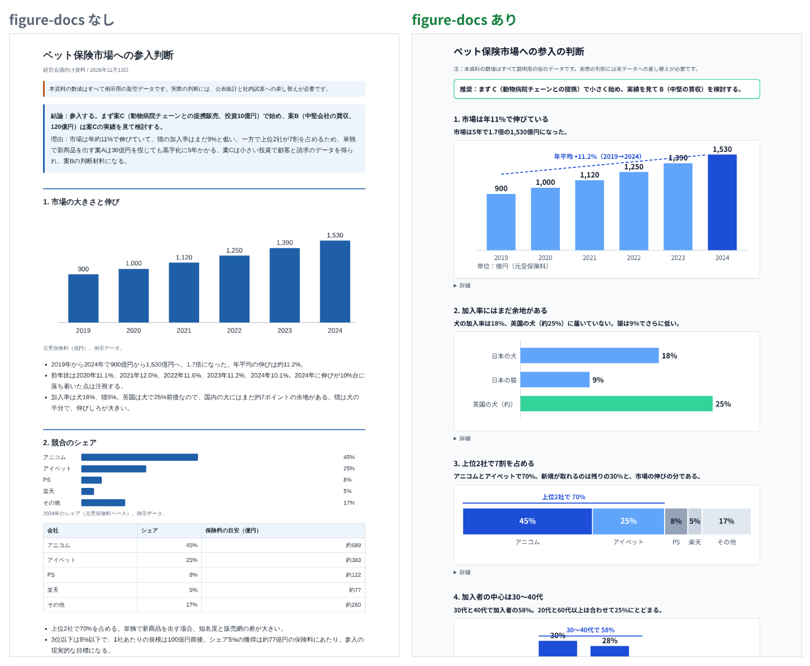
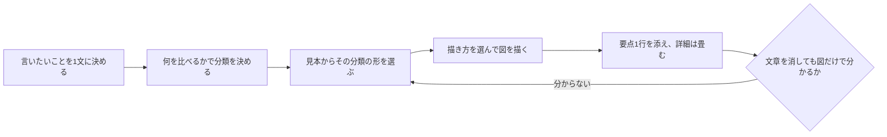
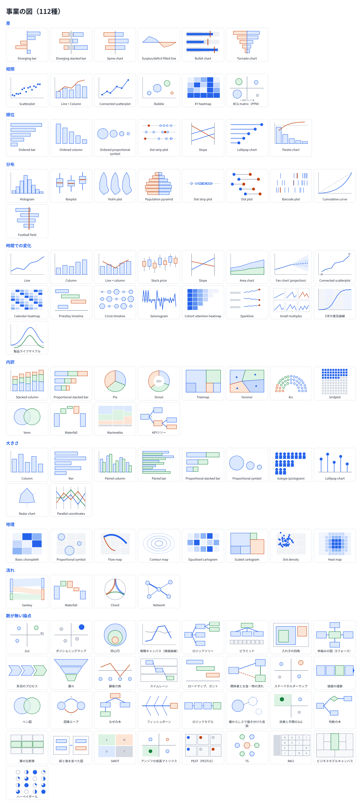
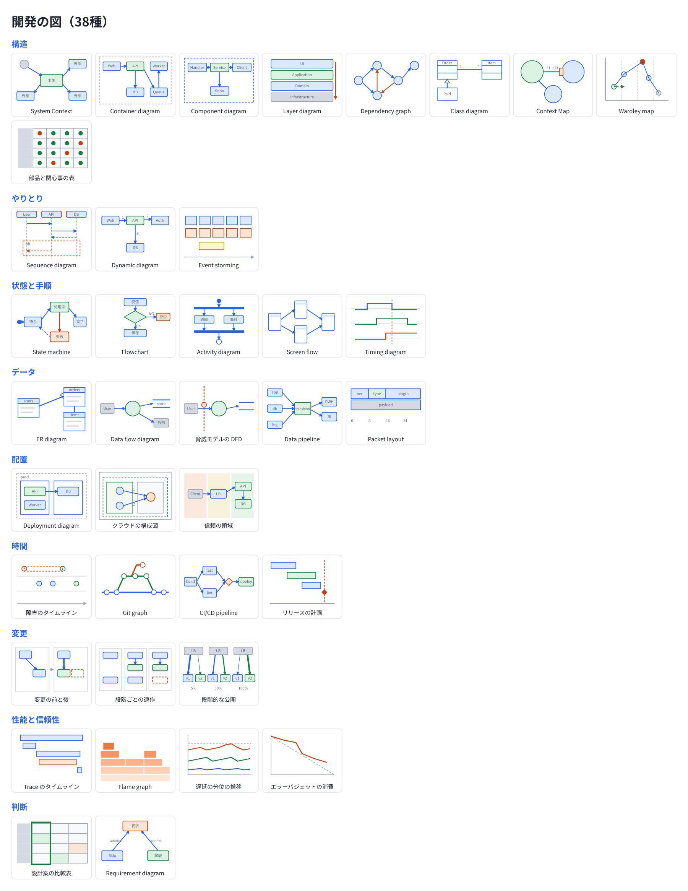

# figure-docs

人に読ませる資料を、図を中心に作り切るための skill。言いたいことごとに図の形を先に決めて描き、文章は図ごとの要点1行にする。事業の資料（事業企画、マーケティング、市場調査、事業計画）と、開発の説明（設計書、PR の説明、障害の報告、移行の計画）の両方に使う。

## 何が出るか

同じ依頼（「ペット保険市場に参入すべきかを判断する資料を作って」、数値は架空）で、figure-docs を読ませない場合と読ませた場合に Claude が作った資料の先頭部分。



| | figure-docs なし | figure-docs あり |
|---|---|---|
| 節の見出し | 「市場の大きさと伸び」のような題 | 「市場は年11%で伸びている」のような言いたいこと1文 |
| 図 | 1つ（ほかは横棒と表） | 7つ（節ごとに1つ。散布図、ガント、因果の矢印の図など） |
| 表 | 4つ | 0 |
| 見えている文字 | およそ1,770字 | およそ490字（詳細は畳む） |

## 動き

skill を読んだエージェントは、資料の節ごとに次の順で進める。形から先に決めず、文章は図の後に足す。



描き方は、次の順で最初に当てはまるものを使う。

1. Artifact の側にその形の描き方があればそれを使う（Artifact の tool が作れる種類と、artifact-design、artifact-diagramming、dataviz などの skill）。
2. 開発の図で、置き場所が Mermaid を表示できる（GitHub の Markdown、Artifact）なら Mermaid で書く。
3. どちらも無ければ、見本の svg を写して描く。位置の計算が要る図（Sankey、Treemap など）と地図は、d3 などで位置を計算した結果を svg にして埋め込む。

## 出す資料の形

| 資料 | 形式 |
|---|---|
| 事業の資料、報告、判断の資料 | 1つの HTML のページ。Artifact を作れる環境では Artifact |
| GitHub に置く開発の説明（PR、issue、設計書） | Markdown に Mermaid の図を入れる。図が多いときは HTML のページ |
| Word、PDF などを名指しされたとき | その形式 |

日本語はゴシック体にし、HTML では Google Fonts の Noto Sans JP を読み込む。図の中の文字は部品の名前と値と数語の注記にし、文は図の下の要点1行か、畳んだ詳細に置く。

## 図の分類と見本

見本は、図ごとに名前、形（何を、どの軸や位置や線や色で描くか）、使う場面、最小の svg を持つ。開発の図には、描ける Mermaid の種類も添えてある。

### 事業の図（112種）

数のある図の分類と名前は Financial Times Visual Vocabulary（MIT）による。見本の全体は [references/business.html](skills/figure-docs/references/business.html)。

| 分類 | 使う場面 | 図の例 |
|---|---|---|
| 差（6） | 0、目標、平均などの基準からの上下 | Diverging bar、Bullet chart、Tornado chart |
| 相関（6） | 2つ以上の値の関係 | Scatterplot、Bubble、BCG matrix |
| 順位（7） | 並びの中の位置 | Ordered bar、Slope、Pareto chart |
| 分布（9） | 値がどこにどれだけあるか | Histogram、Boxplot、Football field |
| 時間での変化（17） | 傾向の変わり方 | Line、Fan chart、Cohort retention heatmap、S字の普及曲線 |
| 内訳（12） | 全体を部品に分ける | Stacked column、Treemap、Waterfall、Marimekko、KPIツリー |
| 大きさ（10） | 数えた量の比較 | Bar、Paired bar、Isotype |
| 地理（8） | 場所や地域の違い | Basic choropleth、Flow map、Scaled cartogram |
| 流れ（4） | 状態や場所の間を動く量 | Sankey、Chord、Network |
| 数が無い論点（33） | 位置づけ、枠組み、手順、関係、因果、判断、前と後 | 2x2、ロジックツリー、スイムレーン、フィッシュボーン、SWOT、ビジネスモデルキャンバス |



### 開発の図（38種）

見本の全体は [references/dev.html](skills/figure-docs/references/dev.html)。分類は C4 model、UML、arc42、DDD、STRIDE、SRE の定番から取った。

| 分類 | 見せること | 図の例 |
|---|---|---|
| 構造（9） | 何がどの部品でできていて、依存の向きはどうか | System Context、Container diagram、Layer diagram、Class diagram |
| やりとり（3） | 誰が誰にどの順で何を頼むか | Sequence diagram、Dynamic diagram、Event storming |
| 状態と手順（5） | 状態の変わり方、処理の分かれ | State machine、Flowchart、Screen flow |
| データ（5） | 何がどこに入り、どう流れるか | ER diagram、Data flow diagram、脅威モデルの DFD |
| 配置（3） | どこで動き、どの境界をまたぐか | Deployment diagram、クラウドの構成図、信頼の領域 |
| 時間（4） | いつ何が起き、どの順で進むか | 障害のタイムライン、Git graph、CI/CD pipeline |
| 変更（3） | 前と後の違い、移す順 | 変更の前と後、段階ごとの連作、段階的な公開 |
| 性能と信頼性（4） | どこで時間を使い、どれだけ失敗してよいか | Trace のタイムライン、Flame graph、エラーバジェットの消費 |
| 判断（2） | 案の比べ方と選んだもの | 設計案の比較表、Requirement diagram |

スイムレーン、ガント、判断の木、なぜの木、Sankey は、事業の図の見本にある形を使う。

開発の図は次も守る。四角は1枚に6つまでにし、つながらない四角は描かない。矢印には何を渡すかを書く。部品が3つ以上増える構成や3段階以上の移行は、段階ごとに1つずつ足す連作にする。変更の前と後は同じ配置で並べ、足すものを緑、消すものを赤の点線、変えるものを太線にする。



## 使われる場面

skill の説明文（SKILL.md の description）は「人に読ませる資料を作るとき」で、報告、草案、比較や判断の資料、事業の資料、開発の説明を、HTML のページ、Artifact、Markdown のどれで作るときも当たる。この説明文に当たる依頼のとき、エージェントがこの skill を読む。

## ファイル

```
plugin.json                          Agent Plugins の manifest
.claude-plugin/plugin.json           Claude Code の manifest
skills/figure-docs/SKILL.md          skill の本文（選ぶ順、資料の形式、分類、描き方の決まり）
skills/figure-docs/references/business.html  事業の図の見本
skills/figure-docs/references/dev.html       開発の図の見本
LICENSES/FT-Visual-Vocabulary.txt    FT Visual Vocabulary の著作権の表示
images/                              この README の画像
```

入れ方はリポジトリの [README](../../README.md#入れ方) にある。

## ライセンス

MIT。事業の図の分類と名前は Financial Times Visual Vocabulary（MIT）による。著作権の表示は [LICENSES/FT-Visual-Vocabulary.txt](LICENSES/FT-Visual-Vocabulary.txt)。
