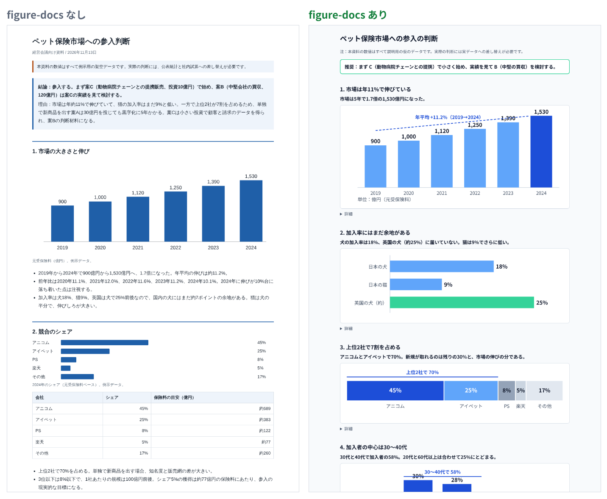
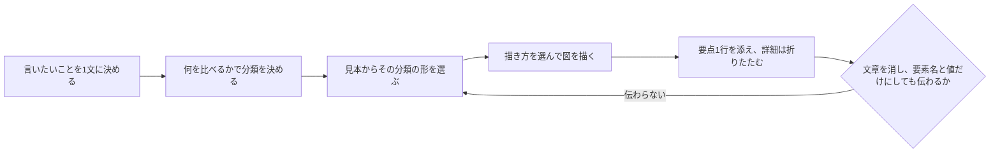
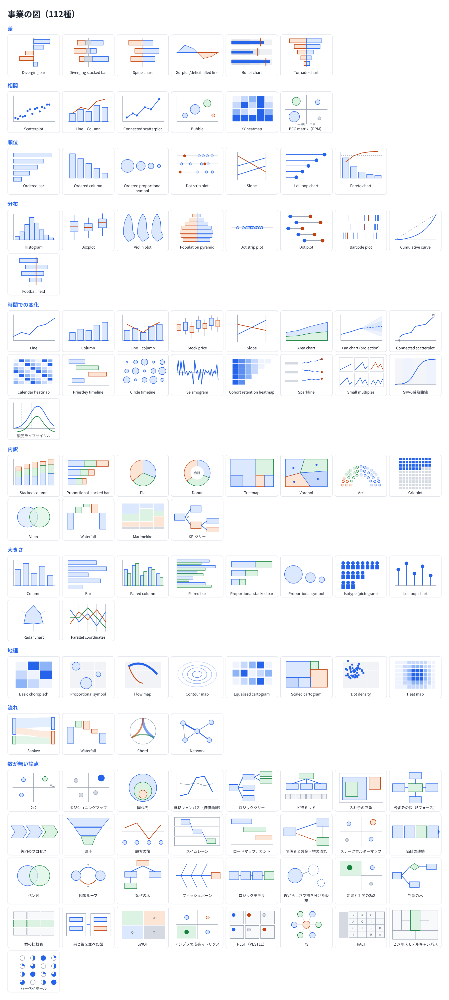
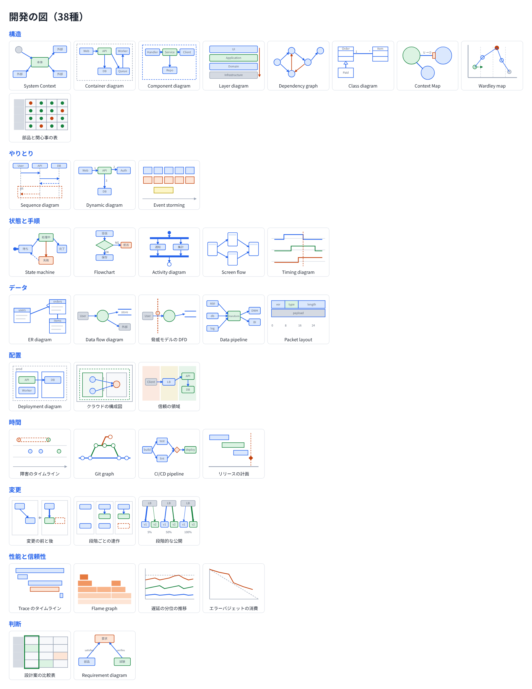

# figure-docs

人に読ませる資料を、図を中心に仕上げるための skill。言いたいことを1文に決めて図の形を先に選び、文章は図ごとの要点1行にとどめる。事業の資料（事業企画、マーケティング、市場調査、事業計画）と、開発の説明（設計書、PR の説明、障害の報告、移行の計画）の両方に使える。

## 紹介動画

37秒、音声なし。前半は Claude Project のスレッドの返信に図が出て論点を切り替える様子、後半は Claude Code や Gemini などでも同じに作られる資料の比較と図の見本、最後に入れ方を示す。返信と資料の例は架空のもの。


同じ内容の MP4：[images/figure-docs-intro.mp4](images/figure-docs-intro.mp4)

## 何が出るか

同じ依頼（「ペット保険市場に参入すべきかを判断する資料を作って」、数値は架空）に対し、figure-docs なしで作成した場合と、figure-docs を読んで作成した場合の先頭部分の比較。



| | figure-docs なし | figure-docs あり |
|---|---|---|
| 節の見出し | 「市場の大きさと伸び」のような題名 | 「市場の大きさと伸び率」のように役割と論点を示す読点なしの短い名詞句にして名詞で終え、「市場は年11%で伸びている」のような言いたいこと1文を見出し直後か図の直後の要点の行に書く |
| 図 | 1つ（ほかは横棒と表） | 7つ（節ごとに1つ。散布図、ガント、因果の矢印の図など） |
| 表 | 4つ | 0 |
| 見えている文字 | およそ1,770字 | およそ490字（詳細は折りたたむ） |

## 資料を作る手順

skill を読んだエージェントは、資料の節ごとに次の順で進める。図の形から先に決めず、文章は図を描いた後に足す。



描き方は、次の順で最初に当てはまるものを選ぶ。

1. Artifact 側にその形の描き方があればそれを使う（Artifact のツールが作れる種類や、`artifact-design`、`artifact-diagramming`、`dataviz` などの skill）。
2. Artifact、HTML、Word、PDF では、見本をもとに SVG で描く（配置と色を読みやすさに合わせて決められるため）。位置の計算が必要な図（Sankey、Treemap など）と地図は、d3 などで計算した結果や簡略化した境界データを SVG として埋め込む。
3. リポジトリの文書（障害の報告や設計書など）には Markdown に Mermaid の図を入れる。GitHub の PR の説明と issue には図を描かず、図を置いた文書へのリンクを書く。

## 出力する資料の形式

| 資料 | 形式 |
|---|---|
| Word、PDF などを名指しされたとき | 指定された形式 |
| GitHub のリポジトリの文書（障害の報告や設計書など） | Markdown に Mermaid の図を入れる。図が多いときや Mermaid で描けない形が必要なときは HTML ページ |
| GitHub の PR の説明と issue | 図を描かず、図を置いた文書へのリンクを書く |
| それ以外の資料（事業の資料、報告、草案、比較・判断の資料など） | 1つの HTML ページ。Artifact を作れる環境では Artifact |

日本語は図やグラフの中も含めてゴシック体にし、HTML では Google Fonts の Noto Sans JP を読み込む。図の中の文字は、何を指すか分かる要素名、何の値か分かる値、数語の注記にとどめ、文章は図の下の要点1行か、折りたたんだ詳細に置く。

## 図の分類と見本

見本には、図ごとに名前、形（何をどの軸・位置・線・色で描くか）、使う場面、最小の SVG をまとめている。開発の図には、描ける Mermaid の種類も添えてある。

### 事業の図（112種）

数値のある図の分類と名前は Financial Times Visual Vocabulary（MIT）に基づく。見本の全体は [references/business.html](skills/figure-docs/references/business.html)。

| 分類 | 使う場面 | 図の例 |
|---|---|---|
| 差（6） | 0、目標、平均などの基準からの上下 | Diverging bar、Bullet chart、Tornado chart |
| 相関（6） | 2つ以上の値の関係 | Scatterplot、Bubble、BCG matrix |
| 順位（7） | 並びの中の位置 | Ordered bar、Slope、Pareto chart |
| 分布（9） | 値がどこにどれだけ集まっているか | Histogram、Boxplot、Football field |
| 時間での変化（17） | 傾向の変わり方 | Line、Fan chart、Cohort retention heatmap、S字の普及曲線 |
| 内訳（12） | 全体を要素に分ける | Stacked column、Treemap、Waterfall、Marimekko、KPIツリー |
| 大きさ（10） | 数えた量の比較 | Bar、Paired bar、Isotype |
| 地理（8） | 場所や地域の違い | Basic choropleth、Flow map、Scaled cartogram |
| 流れ（4） | 状態や場所の間を動く量 | Sankey、Chord、Network |
| 数が無い論点（33） | 位置づけ、枠組み、手順、関係、因果、判断、前と後 | 2x2、ロジックツリー、スイムレーン、フィッシュボーン、SWOT、ビジネスモデルキャンバス |



### 開発の図（38種）

見本の全体は [references/dev.html](skills/figure-docs/references/dev.html)。分類は C4 model、UML、arc42、DDD、STRIDE、SRE の定番から選んだ。

| 分類 | 見せること | 図の例 |
|---|---|---|
| 構造（9） | 何がどの部品でできていて、依存の向きはどうか | System Context、Container diagram、Layer diagram、Class diagram |
| やりとり（3） | 誰が誰にどの順で何を頼むか | Sequence diagram、Dynamic diagram、Event storming |
| 状態と手順（5） | 状態の変わり方、処理の分かれ | State machine、Flowchart、Screen flow |
| データ（5） | 何がどこに入り、どう流れるか | ER diagram、Data flow diagram、脅威モデルの DFD |
| 配置（3） | どこで動き、どの境界をまたぐか | Deployment diagram、クラウドの構成図、信頼の領域 |
| 時間（4） | いつ何が起き、どの順で進むか | 障害のタイムライン、Git graph、CI/CD pipeline |
| 変更（3） | 前と後の違い、移す順 | 変更の前と後、段階ごとの連作、段階的な公開 |
| 性能と信頼性（4） | どこで時間を使い、どれだけ失敗してよいか | Trace のタイムライン、Flame graph、エラーバジェットの消費 |
| 判断（2） | 案の比べ方と選んだもの | 設計案の比較表、Requirement diagram |

役割ごとの手順（スイムレーン）、期間の計画（ロードマップ、ガント）、条件の分かれ（判断の木）、原因の分解（なぜの木、フィッシュボーン）、量の流れ（Sankey）は、事業の図の見本にある形を使う。

開発の図では、次の基準も守る。

- 1枚の図の四角は6つまでとし、ほかの四角とつながらない四角は描かない。
- 矢印には渡す内容（呼び出し、データ名、方式）を書く。
- 部品が3つ以上増える構成や3段階以上の移行は、段階ごとに1つずつ足す連作にする。
- 変更の前と後は同じ配置で並べ、追加を緑、削除を赤の点線、変更を太線で示す。



## 使われる場面

`SKILL.md` の `description` には、返信で仕組み、原因、調査の結果、案の比較などを説明するときは、調べ終えて返信を書き始める直前に必ずこの skill を呼ぶこと（このセッションでまだ呼んでいなければ。compact の後も同じ）と、人に読ませる資料を作るときに使うことを記しており、報告、草案、比較・判断の資料、事業の資料、開発の説明を、HTML ページ、Artifact、Markdown のどれで作るときも、チャットの返信で仕組みや案の比較を説明するときも対象になる。返信では書く前に図を描いて構造を確かめ、返信の中の図で済ませるか資料を作るかを決める（`SKILL.md` の「説明の返信」）。返信に図を描くときは、返信の中に SVG を描く道具があれば SVG、無ければ Mermaid で描く。GitHub の PR と issue には図を描かず、図を置いた文書へのリンクを書く。これに該当する依頼を受けたとき、エージェントがこの skill を読み込む。

## ファイル構成

```
plugin.json                                  Agent Plugins の manifest
.claude-plugin/plugin.json                   Claude Code の manifest
skills/figure-docs/SKILL.md                  skill の本文（選び方、資料の形式、分類、描き方のルール）
skills/figure-docs/references/business.html  事業の図の見本
skills/figure-docs/references/dev.html       開発の図の見本
LICENSES/FT-Visual-Vocabulary.txt            FT Visual Vocabulary の著作権表示
images/                                      この README で使う画像
```

インストール手順はリポジトリの [README](../../README.md#入れ方) を参照。

## ライセンス

MIT。事業の図の分類と名前は Financial Times Visual Vocabulary（MIT）に基づく。著作権表示は [LICENSES/FT-Visual-Vocabulary.txt](LICENSES/FT-Visual-Vocabulary.txt)。
