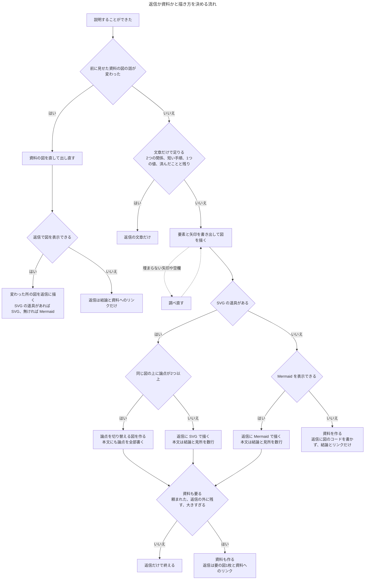

# 図を中心にした資料の作り方

## 基本の進め方

- **図を先に描き、文章は要点1行にする**：言いたいことを1文に決め、下の「図の形を選ぶ手順」に沿って図を先に描く。文章は図ごとの要点1行にとどめる。
- **節の見出しと図のタイトルは論点を示す短い名詞句にする**：見出しと図のタイトルは対象や論点を示す短い名詞句にして名詞で終える。結論の1文を見出しにする型は英語圏の資料の書き方で、日本語の章題としては不自然である。見出しと図のタイトルに読点（、）を入れず、動詞や「です」「だけです」で終わる文にしない。対象名だけに縮めず、節の役割（問題、原因や構造、対策、比較、確認結果、未確認事項）と論点（何が問題か、何の原因や対策か、何と何を比べるか、どの条件を扱うか）を落とさない。結論となる言いたいこと1文は見出しに入れず、見出しの直後か図の直後の要点の行に書く。例えば見出しは「市場の大きさと伸び率」とし、要点の行に「市場は年11%で伸びている」と書く。
- **詳細は折りたたむ**：補足や根拠の詳細は折りたたみ、開いた中も図と要点1行で説明する。
- **図だけで伝わる形にする**：文章を先に書いて図を添えるやり方や、文章をそのまま図の中に移すやり方では、図付きの文章になって読み手が要点をつかめない。完成前に、文章を消して図中の文字も要素名と値だけにした状態で、位置・長さ・線・色から言いたいことが伝わるかを確認する。

## 図・表・文章の使い分け

- **図にするもの**：3つ以上の要素や関係者の関係、画面や状態をまたぐ流れ、変更の前後、時間で変わる数値、3つ以上の数値の比較、正と負を含む内訳。
- **表にするもの**：行と列の欄に文章が入る対応は、HTML か Markdown の表にする。SVG では描かない。SVG は位置・長さ・線が意味を持つ図にだけ使う。表を SVG で描くと文字が重なりやすく、修正もしにくい。
- **文章で書くもの**：2つのものの関係、分岐のない短い手順、単独の数値。
- **資料を見せた後の質問への答え方**：数値の動きや内訳を聞かれたとき（例：なぜ増えたか、いつ足りなくなるか）も、数値の表で返さず、その問いに答える図を1枚描く。表のままでは、読み手が自分で差を計算することになる。

## 説明の返信

- **対象**：チャットの返信で、上の「図にするもの」に当たる説明（仕組み、原因、案の比較、試した結果と次の案など）を書くときに使う。
- **書く前の工程**：まず図に置く要素と、誰が何をどこへ渡すかの矢印を一覧に書き出し、「図の形を選ぶ手順」で図を描く。矢印や空欄が埋まらない所はまだ分かっていない所なので、調べてから描き直す。文章は図を見て書く。文章から書くと抜けたまま長くなる。
- **基本の形**：返信の中に図を描くときは、次の順で描き方を選ぶ。図にしにくい比較は返信の中の表にする。1枚の図が答える問いは1つにする。タイトルを1つの問いで書けない図は問いごとに分けて返信に並べる（同じ図の上に論点が2つ以上あるときは、下の「論点の切り替え」）。問いが1つでも、開発の図で四角が6つを超えるときは図を分ける。1枚に収めるために要素や矢印を削らない。判断を頼むときも、案は返信の中の図か表で並べ、推奨する案と理由も返信に書く。判断のたびに HTML 資料を作らない。
  1. 返信の中に SVG や HTML の断片をそのまま描く道具がある場所（例：Claude のプロジェクトのスレッドとチャットの post_widget の show_widget）では、返信の中に SVG で描く。色や文字の指定は、明暗の切り替えのために道具の説明が決めているとおりに従う（色を class で指定するなど）。show_widget の title 引数は識別用で画面に出ないため、図のタイトルは SVG の中の上端に text で描く。道具で図を出すと文章の返信とは別の書き込みになるため、図を先に出し、続く文章の返信で結論と図の見所を数行で書く。
  2. そのような道具が無く、返信の場所が Mermaid を表示できるときは、返信の本文に Mermaid で描く。
  3. どちらもできない場所では返信に図のコードを書かず、結論と資料へのリンクだけを書く。
- **論点の切り替え**：1つの図の上に論点が2つ以上あるとき（例：状態の図で依頼とずれている所が2つある、棒グラフで説明したい期間が2つある）は、論点ごとに別の図を描かず、1つの図のまま論点を「戻る／次へ」で切り替える。図ごとに配置が変わると読み手は毎回図を読み直すが、配置と色を変えずに濃さだけを変えれば、変わった所だけを見ればよい。論点が1つのときは使わない。論点ごとに図に描く物が違い、1つの図に収まらないときも使わず、今までどおり論点ごとに図を描いて返信に並べる。1画面が答える問いは1つにし、開発の図では四角を図全体で6つまでにする（「図ぜんぶを見る」で全体を見ても読めるようにするため）。
  - **作り方**：返信の中に HTML を描く道具（show_widget）で、[scripts/stepper.mjs](scripts/stepper.mjs) に図の SVG と論点の一覧を渡して作る。SVG では、論点で色を変える要素（四角、棒、台形など）の `<g>` に `data-box`、矢印や線とその文字をまとめた `<g>`（線の無い文字の札も含む）に `data-arrow` の名前を付ける。指定の形は [scripts/examples/login-lock.json](scripts/examples/login-lock.json) を見る。スクリプトは次の順に並べ、論点が1つの指定、図に無い要素を指す論点、色の値を直接書いた図を断る。
    1. 図のタイトルと、図の前提になる原文（依頼の文など）
    2. 論点の番号と名前の一覧（最初から全部見え、押すとその論点に移る）
    3. 今の論点に関わる要素（四角、棒、台形、矢印など）の枠を太くし、ほかを薄くした図。色は図の中で意味を持つため（例：オレンジを「減った」に使う棒グラフ）、論点を示すために色を変えない（論点の起点の要素は枠をさらに太くし、その論点でその要素が何なのかを書いた札を `mark` で付けられる。例：「ここから入れてしまう」。どの論点にも同じ言葉を付けない）
    4. 図の下の結論1行と、「戻る／次へ」「図ぜんぶを見る」
  - **見落としへの備え**：道具の text 引数には、スクリプトが出す「タイトル（論点2つ：A、B）」の文を使い、続く文章の返信にも論点を全部書く。プレビュー、通知、プロジェクトのチャットの要約には図が出ず、「次へ」を押さない読み手は2つ目以降の論点に気付かないため。スクリプトが動かない表示でも、論点の一覧と結論は読める。
  - **確認**：`--preview DIR` で、明るい画面と暗い画面の確認用のページができる。下の「出す前に確かめる」のとおり、論点ごとに表示したスクリーンショットを読む。
  - **道具が無い場所**：Mermaid だけを表示できる返信、リポジトリの文書、資料では切り替えを使わない。同じ図1枚の要素に論点の番号を振り、図の下に番号ごとの結論1行を並べる。
- **PR の説明、issue、そのコメント**：図を描かない。図が要る話（大事な設計、仕組み、原因）は、リポジトリの文書（設計書など）か HTML 資料に置き、PR と issue からはその文書や資料へリンクする。大事な設計はリポジトリの文書に残す。
- **資料を作るとき**：HTML 資料（Artifact）などを作るのは次のときだけにする。資料の形式（HTML、Artifact、Markdown、指定された Word や PDF）は「資料の形式」の節で決める。資料を作るときも、図を表示できる場所では返信の中に要の図を1枚描き、資料へのリンクを添える。返信の場所が図を表示できないときは、返信に図のコードを書かず、結論と資料へのリンクだけを書く。
  1. 読み手が資料を頼んだとき
  2. ほかの人に渡す資料のように返信の外に残すとき
  3. 返信の場所が図を表示できないとき
  4. 図が大きすぎて返信の中では読めないとき
- **前に見せた資料があるとき**：前に見せた資料の図の話が変わったときは、資料の図を直して同じ場所に出し直す。返信の場所が図を表示できるときは、返信の中にも変わった所の図を描く。表示できないときは、結論と資料へのリンクだけを書く。図の読み方を聞かれただけなら、資料は直さずに答える。
- **返信の本文**：結論と図の見所を数行にまとめる。図に描いたことを文章で繰り返さない。経緯や理由も、図にするものなら段落で並べない。図にしない事実の一覧や補足の文は図の中に書かず、返信の文か表に書く。
- **文章だけで返すもの**：2つのものの関係、短い手順、1つの値、済んだことと残りの報告は図を描かずに文章だけで返す。

この節の決め方を図にすると次のとおり。節の文を直すときは、この図も同じ commit で直す。

## 言葉のそろえ方と読み手への配慮

- **用語をそろえる**：読み手が使っている名称に合わせ、同じものを図と文章で別の名前で呼ばない。
- **記号や略称はその図の中で説明する**：「案 A」「証明1」のような作業中に付けた記号や略称を図に出すときは、何を指すかを同じ図の中に書く。
- **元の文脈なしで通じる表記にする**：見出し、図中の要素名、カードの隅などに置く短い文字は、資料を作った会話も元の資料も知らない読み手が、その文字と上の見出しだけで何を指すか分かる言葉にする。値には何の値かを添える（例：「要る時：11月末」ではなく「承認が必要な時期：11月末」）。
- **ほかの資料から見出しを借りるときも書き直す**：元の文脈を外して単独で読めるかを確認し、要素名と値だけに縮まって意味が通じない見出しは書き直す。

## 資料の形式

- **形式を指定されたとき**：Word や PDF などを名指しされたら、その形式で作る。
- **置き場所が GitHub の Markdown のとき**：リポジトリの文書（障害の報告や設計書などの開発の説明）は、Markdown に Mermaid の図を入れて書く。PR の説明と issue には図を描かず、図を置いた文書へのリンクを書く。図が多い説明や、Mermaid で描けない形が必要なときは、下の1つの HTML ページ（Artifact を作れる環境では Artifact）にする。
- **それ以外の資料（事業の資料、報告、草案、比較・判断の資料など）**：1つの HTML ページで作る。Claude のように Artifact を作れる環境では Artifact にする。
- **日本語のフォント**：図やグラフの中も含めてゴシック体にし、明朝体は使わない。HTML では Google Fonts の Noto Sans JP を読み込み、`font-family: "Noto Sans JP", "Hiragino Sans", "Yu Gothic", Meiryo, sans-serif` を指定する。指定しないと明朝体で表示される環境があり、読み込まないと端末ごとに字体が変わる。
- **図の中の文字**：何を指すか分かる要素名、何の値か分かる値、数語の注記にとどめる。四角の中に文章を詰め込むと図の形をした文章になり、読み手に文章を読ませることになる。文章は図の下の要点1行か、折りたたんだ詳細に置く。
- **幅と文字の大きさ**：図は資料の本文の幅に収め、表示時の文字を 11px 未満にしない。要素が多くて収まらないときは、全体図と部分図に分ける。

## 図の形を選ぶ手順

1. **問いと言いたいことを1文に決める**：読み手がその図を見て何を判断するかから問いを決め、言いたいことを1文にする（例：「A の市場は B の3倍ある」「決済の失敗は API と外部決済サービスの間で起きる」）。1枚の図で答える問いは1つに絞り、聞かれていない話題を混ぜない。判断が別の量（人数、件数、時期など）に左右されるなら、その量を図の軸か線にする。
2. **分類を決める**：その1文が何を比べるか、何を見せるかを、下の「事業の図の分類」または「開発の図の分類」から選ぶ。
3. **見本から形を選ぶ**：決めた分類の図から形を選ぶ。事業の図は [references/business.html](references/business.html)、開発の図は [references/dev.html](references/dev.html) にある。形から先に決めない。なお、分類と見本の一覧は目安であり、言いたいことに合わなければほかの形を選んでよい（1つの型に固定すると、どの資料も同じ構成になる）。
4. **描き方を選ぶ**：上から順に見て、最初に当てはまる描き方を選ぶ。
   1. **Artifact 側の描き方**：Artifact のツールが作れる種類や、`artifact-design`、`artifact-diagramming`、`dataviz` などの skill を使う。配色・明暗・操作性が整っているため、これらを優先する。直す元の資料の図や操作も使う。
   2. **SVG**：Artifact、HTML、Word、PDF と、返信の中に SVG を描く道具があるチャットの返信では、見本をもとに SVG で描く（Word や PDF には画像にして入れる）。配置・色・文字の大きさを読みやすさに合わせて決められる。Artifact や SVG を描く道具があるチャットでは読みやすさと見た目を優先するため、Mermaid を先に選ばない。後で図を読み直すときは、画像として読むことと要素・矢印の一覧で足りる。
   3. **Mermaid**：SVG を描く道具が無く Mermaid を表示できるチャットの返信と、リポジトリの文書では、表示できる種類の Mermaid で描く。見本に添えた種類は目安とする。Artifact や SVG を描く道具があるチャットでは SVG を先にする。

見本には、図の名前、形（何をどの軸・位置・線・色で描くか）、使う場面、最小の SVG が並び、開発の図には描ける Mermaid の種類も添えてある。名前だけでは形が浮かばない図は、ファイル全体を読まず、図の名前で検索して該当する `<figure>` を参照する。見本の SVG は形を示すためのものであり、描く手段を SVG に限定するものではない。

この手順は Gene Zelazny『Say It With Charts』（言いたいこと→比べ方→形の順）に基づく。

位置の計算が必要な図（Sankey、Chord、Network、Contour map、Treemap など）は、作成時に d3 などで座標を計算し、結果を SVG としてページに埋め込む。地図は、都道府県の境界データ（npm の `jpn-atlas` など）を簡略化した `path` にして埋め込む。ページを開くたびに外部ライブラリや境界データを読み込む方式は避ける。

## どの図にも守ること

- **図のタイトル**：返信の SVG、Mermaid、HTML 資料のいずれの図にも、何の図かが分かるタイトルを付ける。タイトルが無いと何の図か分からず、変更の前後を取り違える。変更の前後に関わる図は、今の状態か、直した後か、両方を並べたものかがタイトルで分かるようにする（例：「今の受付の起動の流れ」「直した後の受付の起動の流れ」）。タイトルは名詞で終え、読点（、）や結論の1文は入れない。返信の SVG は SVG の中の上端に `text` で描き、Mermaid は先頭の `---` で囲んだ frontmatter の `title:` に書き、HTML 資料は図のすぐ上に置く。Mermaid で `block-beta` のように `title:` が表示されない種類を使うときは、図のすぐ上の行にタイトルを書く。
- **外枠と起点**：範囲の外枠と処理が始まる箇所から描く。
- **実物と名前の一致**：要素の数、矢印、呼ばれる回数は実物と合わせる。名前は画面・原文・用語集にあるものを使い、PR の番号や作業中の呼び名は出さない。
- **案の並べ方**：案を並べるときは、1つを選ぶのか全部を行うのかを見た目で区別し、推奨する案に目印を付ける。画面の形が論点なら、案ごとの画面の図を描く。
- **凡例**：線の種類や色に意味を持たせたら、凡例を置く。
- **向きの表し方**：向きが意味を持つ所（何が何へ渡るか、どの順に進むか）は SVG でも矢じり付きの線で描き、位置や色だけで向きを示さない。
- **図の確認**：自分や他人が描いた図を確かめるとき、直すとき、図について答えるときは、表示したスクリーンショットを画像として読む。つながりや見え方を取り違えるため、SVG や HTML の座標から意味を取らない。

## 事業の図の分類

数値のある図の9分類と図の名前は Financial Times Visual Vocabulary（MIT）に基づく。

| 分類 | 使う場面 |
|---|---|
| 差 | 0、目標、平均などの基準からの上下 |
| 相関 | 2つ以上の値の関係。因果関係と誤読されやすいので、因果でなければその旨を書く |
| 順位 | 値そのものより、並びの中の位置が大事なとき |
| 分布 | 値がどこにどれだけ集まっているか、偏り |
| 時間での変化 | 傾向の変わり方。期間の取り方で印象が変わる点に注意する |
| 内訳 | 全体を要素に分ける。個々の大きさだけが関心なら「大きさ」を選ぶ |
| 大きさ | 人数、金額など数えた量の比較（率や割合ではない） |
| 地理 | 場所や地域の違いがほかの何より大事なときだけ使う |
| 流れ | 2つ以上の状態や場所の間を動く量（お金、患者、情報など） |
| 数が無い論点 | 位置づけ、構造と分け方、決まった枠組み（SWOT、7S、キャンバス）、役割の分担、手順と時間、関係、因果、確からしさ、優先と判断、前と後 |

視覚的な描き分けを統一する。大きさは面積か長さ、確からしさは線の種類（実線、点線）、関係の近さは距離、重みは線の太さで示す。文章では同じ重みに並ぶ差が、図ではひと目で見える。

## 数値のある図のルール

- **値と目盛りから計算して配置する**：長さ、面積、位置は値と目盛りから計算して置く。座標を手で決めず、小さい値を見せるために伸ばさない。
- **値に比例しない図形を安易に使わない**：大きさの差を伝えるなら、値に比例する形（棒グラフ、面積を値に合わせた入れ子の四角など）を選ぶ。入れ子、同心円、階段を値に比例させずに使ってよいのは、包含関係や順序だけを伝えるときに限る。そのときは金額や数値を形の外に書き、大きさが値を表さないことも図に明記する。比例しない大きさに額を添えると、読み手は大きさで比べてしまう。
- **軸と目盛りを正確に取る**：棒グラフの軸は0から始める。対数軸にするときは軸に明記する。線や棒を図の端で切らず、値が枠を超えるなら目盛りを広げる。並べて比べる図は同じ目盛りにする。桁の違う値は図を分けるか対数軸にする。
- **時間軸は期間に比例させる**：時間の軸は期間の長さに比例させ、長さの異なる期間を同じ幅で並べない。
- **期ごとの額と増減を混同させない**：期ごとの額を比べる図は、期ごとにその期の額だけを積む。前の期からの増減を描くなら、なくなる項目を減る棒で描く。増えた分だけを積むと、前の期だけの費用が次の期にも残っているように見える。合計と内訳の項目を同じ列の棒に並べない。
- **見込み・推計と仮置き値を区別する**：見込みや推計には幅（Fan chart (projection)、範囲つきの棒など）を描き、確定した1つの値に見せない。根拠がなく仮に置いた値は、根拠のある値と線や塗りで描き分け、仮に置いた値だと図に明記する。
- **値がない項目と定性評価の扱い**：値がない項目や未定の項目には大きさも位置も与えず、空の枠と「値なし」の文字で描く。数値のない評価（難しさ、近さ、優先度など）は棒の長さにせず、3段階程度の印か並び順で示す。細かい長さは計測した値に見える。
- **色と凡例をそろえる**：色、縞模様、線の種類の意味は資料全体でそろえ、意味のある色を使う図には凡例を付ける。

## 開発の図の分類とルール

| 分類 | 見せること |
|---|---|
| 構造 | 何がどの部品でできていて、境界と依存の向きはどうか |
| やりとり | 誰が誰に、どの順で、何を頼み、何が返るか |
| 状態と手順 | 状態がどう変わり、処理がどこで分かれるか |
| データ | 何がどこに入り、どう流れ、どう関係するか |
| 配置 | どこで動き、どの境界をまたいで通信するか |
| 時間 | いつ何が起き、どの順で進むか |
| 変更 | 前と後で何が変わり、どの順で移すか |
| 性能と信頼性 | どこで時間や資源を使い、どれだけ失敗してよいか |
| 判断 | 案をどの観点で比べ、何を選ぶか |

次の形は、事業の図の見本（[references/business.html](references/business.html)）を使う。役割ごとの手順（スイムレーン）、期間の計画（ロードマップ、ガント）、条件の分かれ（判断の木）、原因の分解（なぜの木、フィッシュボーン）、量の流れ（Sankey）。

開発の図は次も守る。

- **1枚の四角は6つまで**：四角（要素）は1枚に6つまでにする。超えるときは範囲を分けた図にするか、下の連作にする。四角を詰め込むと、読み手がどこを見ればよいか分からなくなる。
- **孤立した四角を描かない**：どの四角も、ほかの四角と矢印か入れ子でつなぐ。つながらない四角は描かない。
- **矢印に内容と同期・非同期を示す**：矢印には渡すもの（呼び出し、データ名、通信方式など）を書く。同期呼び出しは実線、応答や非同期は点線にする。
- **段階が増える構成は連作にする**：部品が3つ以上増える構成や3段階以上の移行は、同じ配置の図を段階ごとに並べ、各段階で1つずつ足す連作にする。
- **変更の前後は同じ配置で色分けする**：変更の前と後は同じ配置で並べ、追加するものを緑、削除するものを赤の点線、変更するものを太線にする。変わらない箇所には印を付けない。
- **状態の図は先に一覧で検証する**：状態の図は、先に状態と遷移（出来事と条件）を一覧に書き出し、抜けと行き止まりを確かめてから描く。

## 出す前に確かめる

- **図だけで伝わるか**：文章を消し、図中の文字も要素名と値だけにした状態で、位置・長さ・線・色から言いたいことが伝わるかを確認する。
- **数値が資料全体で一致しているか**：図の中の数の合計を、見出し、要点、ほかのページの同じ数値と突き合わせる。同じ量は1つの計算から出し、古い計算結果を資料に残さない。
- **要点が図からはみ出していないか**：要点の1行はその図から読み取れることだけにする。図から読み取れない主張は、図に足すか要点から外す。
- **画面に表示して崩れがないか**：HTML はブラウザで開いてスクリーンショットを撮るなどして、実際の表示を確認する。文字の重なり、はみ出し、ラベルと線の対応、文字の大きさ（11px 以上）を確かめる。
- **既存資料の更新では同じ章を書き換える**：既存の資料を更新するときは、同じ話題の章を書き換える。章やページを足すのは新しい話題のときだけにする。追記を重ねると、読み手が最新の結論を探せなくなる。
